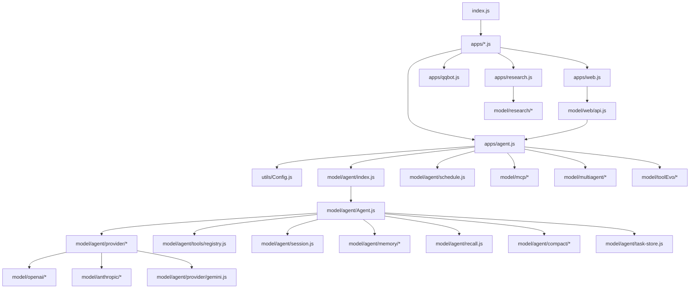

# 00 · 现状源码审计

> 审查对象：`/root/yunzai-agent-plugin`，`dev` 分支，commit `9323c5d31a83df6b63fb478da40cd596eee84dc6`（2026-11-20 13:39:52 +0800）。
>
> 标注约定：**【事实】** 由源码/命令直接验证；**【推断】** 由调用链合理推导但未运行验证；**【待确认】** 需要产品/运维决策或真实 Provider 验证。
>
> 本文件中的 `路径:行号` 均指该 commit。测试与 lint 结果来自 2026-11-20 本机实际执行。

---

## 1. 审查基线与环境

### 1.1 仓库状态

| 项 | 值 | 证据 |
|---|---|---|
| 当前分支 | `dev` | `git status -b` |
| HEAD | `9323c5d31a83df6b63fb478da40cd596eee84dc6` | `git log -1` |
| 默认分支 | `master`（`origin/HEAD -> origin/master`） | `git branch -a` |
| dev 与 master 关系 | 完全相同，`0 0` | `git rev-list --left-right --count master...dev` |
| 远程 dev | 不存在 | `git branch -a` 只有 `origin/master` |
| 工作区 | 干净 | `git status --porcelain` 为空 |
| 版本 | `1.51.1` | `package.json:3` |
| 包类型 | `type: module`，入口 `index.js` | `package.json:15-16` |

没有从 `master` 新建分支：本地 `dev` 已存在且与 `master` 同一 HEAD，满足“基于正确基线”的要求；未修改 `master`。

### 1.2 运行环境

| 项 | 值 |
|---|---|
| OS | Ubuntu 24.04.5 LTS |
| Node | v26.13.1 |
| npm | 11.20.0 |
| pnpm | 12.21.0（AGENTS.md/CI 写的是 pnpm 11；本机实际 12.21.0，lockfile 仍为 9.0） |
| lockfile | `pnpm-lock.yaml`，`lockfileVersion: '9.0'` |
| 初始 node_modules | **不存在**，执行了 `pnpm install --frozen-lockfile`，22.4s 成功 |
| npm registry | `.npmrc` 指向 `https://registry.npmmirror.com` |

### 1.3 源码规模

| 指标 | 数值 | 命令/口径 |
|---|---:|---|
| Git 跟踪文件 | 620 | `find` 去 `.git` |
| JS/MJS/Vue（跟踪） | 548 个文件、121,702 行 | `git ls-files '*.js' '*.mjs' '*.vue' \| xargs wc -l` |
| 测试文件（`test.mjs`/`*.test.mjs`） | 128 | `git ls-files` 过滤 |
| 测试运行器实际发现 | 159 个文件（含 stress/web-dev） | `scripts/run-tests.mjs` 输出 |
| 默认配置 | 755 行，`agent` 下 79 个键 | `config/default_config/config.yaml` |
| Web API | 95 个路由（GET/POST/PUT/DELETE） | `model/web/api.js` |
| Chat 规则 | 71 条（42 条主人规则 + 29 条普通规则） | `apps/agent.js:2020-2107` |

最大文件（行数）：

| 文件 | 行数 | 角色 |
|---|---:|---|
| `apps/agent.js` | 4,429 | 入口、运行时装配、命令、回复编排 |
| `model/agent/test.mjs` | 2,929 | Agent 综合测试 |
| `web/assets/js/views/config.js` | 2,732 | 配置中心前端 |
| `model/agent/Agent.js` | 2,494 | 手写 ReAct 主循环 |
| `model/web/api.js` | 1,560 | Web API |
| `model/crawl/index.js` | 1,078 | 抓取编排 |

### 1.4 测试与 lint 基线（重构前）

执行命令：

```bash
pnpm install --frozen-lockfile
pnpm test
pnpm lint
```

结果：

- `pnpm test`：**147 个文件通过，0 失败，12 跳过，共 159 个文件**；解析到的断言总数 **7,230**；退出码 0。
- 跳过项：`model/agent/vector-gpu.test.mjs`、`model/diagram/kroki.integration.test.mjs`、`model/sandbox/e2b.integration.test.mjs`、`model/stagehand/browser.integration.test.mjs`、`stress/real/{cache-hit-sim,memory-cache-smoke,real-llm-smoke,untrusted-guard-smoke}.mjs`、`stress/anti-misread/{real-llm,run-real}.mjs`、`stress/e2e/{e2e-fullchain,hooks}.mjs`。
- `pnpm lint`：**0 errors，50 warnings**，退出码 0。warnings 主要是 `no-unused-vars`，属存量；本次没有修改业务代码，不新增告警。
- 测试运行器：每个文件独立子进程，180s 超时；`SKIP_FILE:` 且退出码 0 记为 skip；`HOOKED_STRESS` 中的入口测试用 `--import stress/e2e/hooks.mjs` 注入 Yunzai 桩（`scripts/run-tests.mjs:20-124`）。

**基线结论**：现有离线套件是可信的回归网，但主要覆盖手写模块与入口桩；没有 legacy/mastra parity、没有真实 Provider CI、没有多进程/重启恢复的完整 E2E。新增重构必须补测试，不能把“现有 147 通过”当作等价证明。

### 1.5 依赖现状与兼容缺口

| 依赖 | 当前版本 | 与 Mastra 的关系 |
|---|---|---|
| `zod` | `3.23.0` | **不满足** `@mastra/core` peer `^3.25.0 \|\| ^4.0.0`；也不满足 AI SDK `^3.25.76 \|\| ^4.1.8`。PR1 必须升级 |
| `zod-stagehand` | `npm:zod@4.4.3` | Stagehand 专用 Zod 4，必须保留别名隔离 |
| `typescript` | `5.7.2`（runtime dep） | 仅 toolEvo AST 检查用，无构建步骤 |
| `@google/genai` | `2.15.0` | 当前 Gemini 原生传输；AI SDK Google provider 是另一套 API 面 |
| `sqlite3` | `npm:@karinjs/sqlite3@0.4.3` | TaskStore/ToolEvo 本地库 |
| `hnswlib-node` | optional `3.0.0` | 本地 HNSW；安装成功，但仍是 optional |
| `undici` | **未声明** | `apps/agent.js:541-547` 动态 import；本机 `import('undici')` 失败 → `agent.proxy` 实际直连（见 1.6） |

Mastra/AI SDK 目标版本详见 [README](README.md#版本与兼容矩阵2026-11-20-核验)。

### 1.6 审查中确认的既有缺陷（不在本任务修复）

这些缺陷会直接影响重构，必须先记录，避免迁移后被误认为“Mastra 引入”：

1. **`agent.proxy` 在当前依赖下是空操作。** `makeProxyFetch` 动态 `import('undici')`（`apps/agent.js:529-549`），但 `package.json` 未声明 `undici`；本机 `import('undici')` 返回 `ERR_MODULE_NOT_FOUND`，catch 后静默直连。仅打一条 warn。
2. **Gemini 忽略 `baseURL`/`fetch`/代理/自定义 header。** `GeminiProvider` 只读 `apiKey`/`model`，构造 `new GoogleGenAI({apiKey})`（`model/agent/provider/gemini.js:197-199,220`）；`apps/agent.js:614` 传入的 `proxyFetch` 不会被使用。
3. **官方 QQ ID 含 `:`，但多处按键字符串 `split(':')` 解析。** `SessionStore.listAll`（`model/agent/session.js:141-143`）、`listAllConversations`（`session.js:249-252`）、`#清空所有记录` 的 key 解析（`apps/agent.js:4117-4129`）会把 `<appid>:<openid>` 拆错；精确键读写不受影响，但列表/自助清除会漏数据或归错用户。**迁移到 Mastra thread/resource 前必须先修**。
4. **审批只在内存。** `ConfirmStore` 用 `Map`（`model/agent/confirm.js:10-14`），进程重启后 pending 全丢；`#确认/#拒绝` 无法恢复。这与 Mastra HITL 的持久化 snapshot 形成直接差距。
5. **没有进程退出钩子。** `apps/`/`utils/` 没有 `SIGINT`/`beforeExit` 处理；运行时清理只靠 `invalidateRuntime`/`#agent重载`（`apps/agent.js:595,1681-1714,3643-3656`）。Mastra storage/vector 的 `close()` 必须显式挂到生命周期。
6. **Vision 把 `timeout` 透传进请求体。** `VisionService` 调 `provider.chat({timeout})`（`model/vision/client.js:86,137,169`），OpenAI/Anthropic Provider 未解构 `timeout`，会进入 `...rest` 写进 JSON body（`provider/openai.js:21-35`、`provider/anthropic.js:180-194`）；严格端点可能 400。
7. **`#qqbot重连` 等命令没有权限门。** `apps/qqbot.js:637-643` 的规则没有 `permission:'master'`，`installMasterGate` 只处理 `permission:'master'` 的规则（`model/qqofficial/guard.js:87-122`），任何用户可触发重连；`#知识库列表` 任意用户可枚举，`#人设详情` 会把完整 systemPrompt 打给任意用户（`apps/agent.js:2041,2071,4254-4259`）。
8. **生产流式硬关闭。** `wantStream` 只由 `process.env.AGENTS_STREAM_TEST === '1'` 决定（`apps/agent.js:2509`），正常用户永远走整段回复；`onDelta` 仍被用于计数和节流发送器，但发送器 `enabled` 为 false。
9. **DevLog 不脱敏、不轮转。** 用户原文/工具参数/结果逐字写盘（`utils/DevLog.js:9-13,139-150`），只有外发回复走 `redactSecrets`；日志目录没有大小上限/轮转。
10. **子 Agent 可读父会话归档/记忆。** `worker-context` 允许 `category:'query'` 工具（`model/multiagent/worker-context.js:31-63`），`context_recall` 不在排除列表，子代理能按父 `convKey` 检索归档（`model/agent/compact/recall.js:89-157`）。这是既有设计风险，迁移时要显式决定保留还是收紧。

### 1.7 工具/审批/子 Agent 专项发现

以下由工具层专项审计确认，直接决定 Tool Adapter 的设计：

1. **`meta` 是承载语义的，不是装饰。** `alwaysConfirm`/`shouldConfirm`/`interactive`/`concurrency`/`resourceKeys`/`effect`/`replay`/`idempotencyKey`/`requires`/`resultCap`/`polling`/`mcp`/`shell`/`groupAdminSkip`/`toolEvoVersionId` 都会改变执行/权限/恢复行为（`Agent.js:2181-2406`；`tool-scheduler.js:57-80`；`tool-effects.js:17-31`）。Adapter 丢任何一个都可能造成安全或恢复回归。
2. **安全门不在工具里。** schema 校验、RBAC、审批、账本、截断、注入标注都在 `Agent._executeOne/_executeToolCalls`；直接 `tool.execute()` 会绕过全部（`Agent.js:2212-2406`）。Mastra Adapter 必须是一个“总守卫”，不能只做参数转换。
3. **生产并发上限是 4，且调度器跨 run 共享。** `apps/agent.js:1316` 注入 `new ToolScheduler({maxParallel:4})`；未声明/第三方/MCP 工具默认 `exclusive`，只有 `READ_PARALLEL_TOOLS` 白名单或显式 `meta.concurrency` 才并发（`tool-scheduler.js:28-80`）。Mastra 的默认并发必须被覆盖，否则会出现同资源并发写。
4. **没有 per-tool timeout。** 调度器只有取消，没有强制超时；一个忽略 `ctx.signal` 的工具可以无限阻塞 `exclusive` 屏障（`tool-scheduler.js:129-156`）。迁移时要把工具自身超时/MCP timeout 纳入统一守卫，不能只依赖 Mastra `maxSteps`。
5. **MCP 工具不接收 `ctx`/`AbortSignal`。** `loadMcpTools` 的 `execute(args)` 只拿参数（`model/mcp/bridge.js:78-91`）；stdio 传输把完整 `process.env` 传给子进程（`model/mcp/transport/stdio.js:23-28`）；默认 category `system`（`bridge.js:15-27`）。Mastra 适配不得放宽默认权限，也不应把 `ctx` 序列化进 MCP。
6. **子 Agent 没有 policy/confirm/taskStore/governor。** `SubagentSpec.runTaskResult` 新建 Agent 时明确不传这些（`model/multiagent/subagent.js:68-78`）；工具仅 `category==='query'`；配额按会话（`#new` 重置），`extend_subagent` 没有总上限（`spawn-tool.js:245-250,434-459`）。这是既有设计，迁移时应保留隔离，同时补预算/配额缺口。
7. **ToolEvo 采纳存在名称竞态。** 生成时检查名称保留，但 `#采纳工具` 的 `tools.replace()` 可能在之后覆盖新出现的 built-in/MCP 同名工具（`model/toolEvo/engine.js:84-90`；`apps/agent.js:2983-2999`；`registry.js:105-116`）。迁移/审批流程必须在采纳时重新检查名称。
8. **工具描述/Schema/MCP 元数据不经过 guard。** 它们直接进入 tools 数组（`Agent.js` 工具目录/请求），是潜在的间接注入通道；现有 guard 只扫用户输入/工具结果/记忆/情境（`guard.js:209-260`；`Agent.js:2404-2405`）。Mastra 迁移不应扩大这个缺口。

---

## 2. 加载入口与运行时装配

### 2.0 模块依赖图（简化）



Mastra 目标态只替换 `AGENT/PROV/OAI/ANT/GEM` 这条内核链；`TOOLS/SESS/MEM/REC/CMP/TASK/SCH/MCP/MA/TE` 仍是项目业务层（见 01）。

### 2.1 插件加载

【事实】`index.js` 读取 `apps/*.js`，并发 `import()`，用 `isPluginClass` 过滤只导出 class（`index.js:32-57`）；`apps` 模块里的同步函数导出会污染 Yunzai loader，因此共享函数必须放 `model/`（`model/llm/embed-wiring.js:3-7`）。`Chat` 构造器里立即 `getRuntime()` 预热（`apps/agent.js:2112-2114`），所以**仅仅 import `apps/agent.js` 就会触发运行时构建**；Mastra 初始化若放在模块顶层，会改变启动时延和失败模式，必须放进 `buildRuntime()`。

【事实】`index.js` 不等待 crawl4ai 自动安装，后台执行（`index.js:68-75`）。Mastra 的 `new Mastra()` 也应是同步/轻量，storage 连接和 `init()` 放异步构建，避免阻塞插件扫描。

### 2.2 运行时单例

`apps/agent.js:448-458` 的模块状态：

- `_runtime`：构建好的运行时对象。
- `_runtimePromise`：并发构建合并。
- `_runtimeFailed`：构建失败缓存；只有 `agent.apiKey` 变为非空才自动重试（`1634-1638`）。
- `_runtimeGen`：代际号，构建期间配置变更则丢弃旧结果（`1642-1649`）。
- `_closingPromise`：旧 runtime `scope.close()` 的屏障，重建前 await（`1690-1692`）。
- `convRunQueues`：每会话 single-flight（`458`）。

`buildRuntime()` 创建 `RuntimeScope`，失败时 `scope.close('build_failed')`（`576-585`）。`_buildRuntime()` 的顺序（`587-1625`）：

1. 注册 active-run abort disposer（order -1）。
2. 校验 `cfg.apiKey`（缺失直接抛，错误文案指向 `providerId/modelId`）。
3. 创建主 Provider、代理 fetch、`primeModelCaps`、`cacheCaps`。
4. `createModelRouter`、`buildEmbed`。
5. 逐条装配 `fallbackModels[]`。
6. 数据迁移、`MemoryStore`、`PersonaStore`、KV、`UsageStats`、`SessionStore`。
7. 可选 `TaskStore`（sqlite）、`RecallStore`、`ProfileStore`、`KnowledgeStore`（GPU 检测/向量目录）。
8. `ConfirmStore`、`ScheduleStore`、KB/persona 定时器。
9. `PersonaService`、`PersonaLore`、`PersonaAdoptionQueue`。
10. Skill、搜索、`CompactionArchive`、Sandbox、ToolRegistry（约 30 类工具）、MCP、辅助 LLM 通道、Prompt/Trace/SelfReview、ToolEvo、Jev、thinking。
11. `agentConfig` + `makeAgent` 工厂。
12. Vision、Multiagent、启动面板。
13. 返回 facade 对象（`1625`）。

`makeAgent()` 每次 `new Agent(agentConfig)`（`apps/agent.js:1333-1335`），共享 provider/tools/session/recall 等引用，但 `this.messages` 独立——这是并发安全的关键。

### 2.3 失效与关闭

`invalidateRuntime()`（`1681-1714`）：

- 清空 `_runtime/_runtimePromise/_runtimeFailed`，`_runtimeGen++`。
- 串接旧的 `_closingPromise`。
- 有 `rt.scope` 时 `scope.close('invalidate')`；否则逐项清理 schedule/knowledge/toolEvo/stagehand/diagram/usageStats/multiagent/taskStore/sandbox。
- 不导出；由 `Config.onChange`（`1717-1720`）和 `#agent重载`（`3643-3656`）触发。

`RuntimeScope`（`model/agent/runtime-scope.js`）：abort 传播、子作用域、按 `order` 顺序等待 disposer、幂等 close、rollback 逆序。disposer 顺序：active-runs -1、schedule 10、knowledge 20、personaLore 25、mcp 30、toolEvo 40、stagehand 50、diagram 60、usageStats 70、multiagent 80、taskStore 90、sandbox 100（`apps/agent.js:595-839`）。

【事实】配置保存会触发 `Config.onChange` → `invalidateRuntime` → `abortAllActiveRuns`（`Agent.js:100`），**保存配置会取消在途长任务**。Mastra 迁移必须保留这一语义或明确改成“仅重建空闲运行时”。

### 2.4 热重载边界

- 只监听 `config/config.yaml`/`config.yaml.tmp`，400ms 防抖（`utils/Config.js:399-418`）。
- ESM 模块缓存导致代码改动必须重启进程；`#agent重载` 只重建实例，不重载模块（`AGENTS.md:34,43`）。
- 旧 Agent 实例持有旧 `agentConfig` 快照，只有新建的 Agent 看到新配置。
- `apps/qqbot.js` 适配器只在模块 import 时注册，配置变更不会自动重连；需要 `#qqbot重连`/`/api/qqbot/reload`。
- Web server 只在 `webApi.enable/port` 变化时重启（`apps/web.js:18-37`）。

---

## 3. 关键调用链

### 3.1 普通群聊/私聊

```
Yunzai event
 → apps/agent.js Chat.onTrigger (2118-2177)
   → self-message 过滤、群消息缓存、MCP JSON 监听、触发模式/指令透传/私聊开关/chatPermission
 → Chat._handleAgent (2212-2889)
   → traceId=randomUUID; getRuntime; ctxOf(e) 计算 identity/scope
   → session.getActiveConversation(scopeUserId, groupId)
   → getConversationMeta → devScope
   → 媒体收集 + 可选视觉子模型 + 引用消息
   → 人设接地 (resolvePersonaGrounding) + perception + skill + 附件清单
   → ReplySender / progress gate / delta streamer / diagram deliverer
   → convRunQueues.run(convKey)
     → rt.makeAgent() → agent.run(input, ctx, callbacks, taskId=traceId)
       → guard 输入检查
       → SessionStore 载入历史（conversation 或 group:user）
       → recall.retrieve / profile.build / memory.snapshotAll → 拼进 user 消息尾部
       → 每轮：_assembleSystem → 压缩水位 → Provider.chat（含 fallback）
       → 工具调用：schema → scheduleIntent 硬门 → policy/confirm → shell 拦截/Jev → onBeforeTool → ToolScheduler → execute
       → LoopGovernor 检查 → 最终答案/反思 → finalizer
       → 持久化 SessionStore（append 或压缩后全量覆写）+ TaskStore 投影
       → setImmediate: recall.extractAndWrite + profile.ingest
     → 回复分支：markdown / image / text；表情包、diagram、keyboard、TTS
     → usageStats.recordRun；taskStore.recordDelivery；terminal(reply_sent/reply_failed/cancelled/run_error)
```

关键证据：`apps/agent.js:2212-2889`、`model/agent/Agent.js:544-1368`、`model/agent/session.js:298-366`、`model/agent/Agent.js:1256-1325`。

### 3.2 流式与取消

- `onDelta` 从 `_handleAgent` 始终传入（`2584`），但 `makeDeltaStreamer` 只在 `wantStream && replyMode==='text'` 时发送（`2538-2542`）。
- `makeDeltaStreamer`：1200ms/24 字符节流；`redactSafeCut` 保证不把半截密钥发出；跨 chunk 的 `[sticker:` 前缀暂存；`finish()` 等待所有分片结算，只有 `sentAny && rawFull===content` 才跳过整段发送（`apps/agent.js:335-430`）。
- `ReplySender` 串行队列，`enqueue()` 永不 reject，15s 非 final 超时，final 不超时（`model/agent/reply-sender.js:57-140`）。
- `convRunQueues` 按 `${gid}|${scopeUserId}|${conversationId}` 串行（`apps/agent.js:2552-2557`）。
- 取消：`abortActiveRun(taskId)` 置 `_runCancelled` 并 abort work signal（`Agent.js:90-107,885`）；`abortAllActiveRuns` 等在途 `runDone`（`100-107`）；`run` 的 finally 才注销 `_activeRuns`（`1364-1367`）。用户取消抛 `aborted`，apps 记 `cancelled` 且不发送迟到结果（`apps/agent.js:2872-2877`）。

### 3.3 工具调用

`Agent._executeOne`（`2181-2406`）顺序：

1. 已取消 → 合成 `cancelled` 结果，不发进度。
2. `onToolStart`。
3. 工具不存在/无 execute/参数非对象 → 结构化错误。
4. `validateToolArgs`（AJV draft-07/2019/2020，`useDefaults:false`，schema 编译失败 fail-closed）（`tool-schema.js:86-113`）。
5. 周期意图硬门：`reminder_set` 在 `_scheduleIntent==='recurring'` 时改路由到 `schedule_task`（`2234-2243`）。
6. `policy.decide`（角色×category；未知 category fail-closed；群管自动放行）（`model/agent/policy.js:28-42`）。
7. `meta.alwaysConfirm`、`meta.shouldConfirm`、`masterSkipConfirm`。
8. `ConfirmStore.request`；无 confirm 器时拒绝（`2280-2300`）。
9. 自定义 shell 拦截、Jev shell 风险。
10. `onBeforeTool` 扩展点；最后取消检查。
11. 合并 `ctx`（保留 e/bot/userId 等，附加 signal/taskId/executionContext/userTexts）（`2341-2343`）。
12. `tool.execute(args, toolCtx)`；异常归一为 `{error}`。
13. 失败富化 `enrichToolFailure`（`_alternatives`/`_hint`）。
14. `devLog('tool')`、`onToolEnd`。
15. 结果封顶 `_capToolResult`（结构化截断 JSON）→ 注入扫描（命中才加 `<untrusted_data>`）→ 返回 tool 消息。

调度层 `_executeToolCalls`（`2039-2132`）：

- 解析 `resolveToolConcurrency` 与 `resolveExecutionMeta`。
- TaskStore `tool_planned` 关键写失败 → 阻止整批副作用。
- 每个任务 `tool_started` 关键写失败 → 阻止该工具。
- `ToolScheduler.run`：`exclusive` 屏障、`resource` 按资源键串行、只读白名单 `parallel`、全局 `maxParallel`；结果按原顺序回插。
- 结算写 `tool_result`，区分 `effect`/`replay`/`effectState`（applied/unknown/none）。

### 3.4 Provider 与回退

- 主 Provider + `fallbackProviders` 数组（每条独立 protocol/baseURL/apiKey/preset/cacheCaps）（`apps/agent.js:644-669`）。
- 每轮 `__tries = [main, ...fallbacks]`；任一异常切下一条，**无错误分类/冷却**（`Agent.js:966-1021`）。
- 流式已输出（`__emitted`）后禁止 fallback，避免重复半截内容（`945-946,974-976`）。
- 主模型上下文超限：学习真实上限 → 压缩到低水位 → 同模型重试一次（`978-1015`）。
- 成功后才 merge usage；失败尝试的 usage 不计（`1025-1031`）。
- 传输层：`transport-base.js:130-241` 默认 4 次重试（5 次尝试），协议特定可重试状态、`Retry-After`、指数退避+抖动；流式响应体有 idle timeout；无熔断器（`model/llm/test.mjs:3-4` 明确旧 CircuitBreaker 已删除）。

### 3.5 会话与记忆

正常一轮的读写顺序（详见 `model/agent/Agent.js`）：

1. `SessionStore.getConversation` / `get` 载入历史；损坏值返回 `null`，拒绝写回（`session.js:51-74,98-116`）。
2. `recall.retrieve(rawText, scopeUserId, topK)`；群共享新 scope 无结果时回退旧 `__group__`（`recall.js:261-287`；`Agent.js:722-730`）。
3. `profile.build(scopeUserId)`；同样有群共享回退（`Agent.js:738-743`）。
4. `memory.snapshotAll(scopeId)`（MEMORY.md/USER.md，按 scopeId 目录隔离）。
5. 以上内容 + 情境 + 技能 + 表情目录（仅首轮）拼成 `dynParts`，包进 user 消息尾部，**不放进 system**（`Agent.js:744-777`）。
6. 每轮 `_assembleSystem` 只拼静态身份/准则/tool catalog/skills/guard（`1489-1573`）。
7. 压缩：`_hysteresisPressure` 80% 触发 → 45% 目标；`compactMessages` 四阶段；归档 `data/context-archive/<safeConvKey>/<epoch>-<hash16>.json`；`cacheEpoch++`（`Agent.js:1724-1783`；`compact/index.js:305-453`）。
8. 持久化：普通轮 append 从 `sessStart` 起的新消息；发生压缩则全量 `setConversation`；检测并发增长则降级 append（`Agent.js:1256-1284`）。
9. `setImmediate` 异步抽取 recall + profile（`1301-1325`）。

### 3.6 审批恢复

- `ConfirmStore.request` 返回 Promise，`#确认/#拒绝` 调 `resolve`，超时/取消结算 false（`confirm.js:32-70`）。
- pending 只在内存；进程重启丢；没有持久化 runId/toolCallId。
- 审批通知 `notifyMaster` 私信所有 `agent.masters`；定时任务路径还会发回原会话（`apps/agent.js:1809-1826,1867-1873`）。
- Web `GET /api/confirm`、`POST /api/confirm/:id/decide`（`model/web/api.js:353-356,1224-1230`）。

### 3.7 定时任务/研究/子 Agent/工具进化

| 能力 | 入口 | 是否复用主 Agent | 关键事实 |
|---|---|---|---|
| 提醒/定时任务 | `reminder_*`/`schedule_task`、`#定时任务` | 是（`makeFireDispatch` 里 `rt.makeAgent()`） | `ScheduleStore` KV 单键 + node-schedule；`ctxFromInfo` 的 `conversationId=null`，走 group:user 历史；fire 路径不走 ReplySender/quote（`apps/agent.js:1967-2007`） |
| 深度研究 | `#研究` | 否（自建 `DeepResearch` + worker `SubagentSpec`） | 五阶段 scope→plan→workers→synthesize→cite→evaluate；不走 TaskStore/UsageStats/ReplySender（`model/research/deep-research.js:54-185`；`apps/research.js:37-103`） |
| 子 Agent | `spawn_subagent`/`check_subagent`/`extend_subagent` 或 `orchestrate` | 是（worker 新建隔离 Agent） | 无 session/recall/memory/guard/policy/confirm；工具白名单 category=query；按会话配额/并发/预算；`shutdown()` 供热重载（`model/multiagent/subagent.js:1-90`、`spawn-tool.js`） |
| 工具进化 | `#进化工具`/`#采纳工具` 等 | 生成/验证用 Agent/runner，审批是命令 | 状态机 draft→verified→stable→quarantined/deprecated；`verified→stable` 必须主人审批（`model/toolEvo/lifecycle.js:18-44`） |
| 人设补齐 | `#人设补齐`/Web | 是（ephemeral Agent） | 只读取材白名单；不读写会话/记忆；产物是草稿+审批队列（`apps/agent.js:1347-1404,1913-1937`） |

### 3.8 关闭与资源

- `RuntimeScope.close` 统一清理；没有进程信号钩子。
- `abortAllActiveRuns` 在 runtime disposer order -1，先取消在途 run，再关 DB/沙箱。
- `TaskStore.close`、`usageStats.flushNow/stop`、MCP `stop`、sandbox `shutdown`、toolEvo runner `stop` + DB close、stagehand `closeAll`、diagram `stop`、KB `shutdown`、multiagent `shutdown`、schedule `shutdown` 均有 disposer。

---

## 4. 功能清单（保留/替换/适配/延期）

| 功能 | 入口 | 核心文件 | 数据 | 测试 | 级别 | 重构风险 |
|---|---|---|---|---|---|---|
| 多模型对话 | `onTrigger`/`#ai` | `apps/agent.js`、`Agent.js`、`provider/*` | Session KV | `model/agent/test.mjs` | P0 | 高：prompt/消息/流式/终止语义 |
| 工具调用 | 模型 tool_calls | `ToolRegistry`、`tool-scheduler`、`tool-schema` | tool 消息、TaskStore | registry/scheduler/schema 测试 | P0 | 高：RBAC/审批/副作用/结果格式 |
| 长期记忆 | `memory`/`memory_search` | `memory/*`、`recall.js` | MEMORY.md/USER.md、KV recall | memory/recall 测试 | P0 | 高：纠错/证据/置信度/隔离 |
| 用户画像 | `#画像`、注入 | `memory/profile.js` | KV profile | profile 测试 | P0 | 中高：统计/纠正/上限 |
| 知识库 RAG | `kb_search`、`#知识库*` | `knowledge.js`、`vector-*` | KV + vectors.bin | knowledge/vector 测试 | P0 | 中：全局共享、embedding 维度 |
| 上下文压缩 | 自动 | `compact/*`、`context_recall` | 文件归档 + ledger | compact 测试（114 断言） | P0 | 极高：无损契约/缓存 epoch |
| 审批 | `#确认/#拒绝`、Web | `confirm.js`、`policy.js` | 内存 | 审批路径散测 | P0 | 高：持久化/恢复/防重 |
| 多对话 | `#new`/`#聊天列表` | `session.js` | KV conv/active/seq | session 测试 | P0 | 高：ID/标题/TTL/迁移 |
| 定时任务 | `schedule_task`、`#定时任务` | `schedule.js` | KV rem:jobs | schedule 相关 | P1 | 中：重启恢复/所有权 |
| 任务账本 | `#任务*`、Web | `task-store.js` | sqlite | task-store 测试 89 断言 | P1 | 高：事件契约/恢复 |
| MCP | `#mcp`/`#添加mcp` | `model/mcp/*` | Config + 内存连接 | mcp 测试 89 断言 | P1 | 中高：命名/权限/生命周期 |
| 子 Agent | `spawn_*`/`orchestrate` | `model/multiagent/*` | 内存任务表 | multiagent 测试 | P1 | 高：隔离/预算/回推 |
| 工具进化 | `#进化工具` | `model/toolEvo/*` | sqlite + 文件 | 多文件测试 | P2 | 高：审批/回滚/沙箱 |
| 深度研究 | `#研究` | `model/research/*` | 内存 state | research 测试 | P2 | 中：交付/预算 |
| 多模态 | 消息媒体 | `media/*`、`vision/*` | 临时文件 | media/vision 测试 | P1 | 高：协议块/能力降级 |
| 流式 | `onDelta` | `apps/agent.js`、provider stream | 无 | `stream-send-accounting` | P1 | 高：当前默认关闭 |
| Web 面板 | `apps/web.js` | `model/web/*`、`web/` | 读运行时 | 多文件 API 测试 | P0 | 高：95 端点直接依赖 rt |
| 人设/Skill | `#人设*`、skills | `persona/*`、`skill/*` | 文件 | persona/skill 测试 | P1 | 中：注入/接地 |
| 可观测性 | DevLog/UsageStats | `trace/*`、`store/usage-stats.js` | 文件/KV | usage/logs 测试 | P1 | 中：字段口径/脱敏 |
| 沙箱/浏览器 | `terminal`/stagehand | `sandbox/*`、`stagehand/*` | E2B/本地 | 集成测试可跳过 | P1 | 中：生命周期 |
| 表情/TTS/图 | 工具 | `sticker/*`、`tts/*`、`diagram/*` | 文件/缓存 | 多文件测试 | P2 | 低中 |

---

## 5. 数据清单

| 数据 | 位置/键 | 格式 | 生命周期 | 迁移注意 |
|---|---|---|---|---|
| conversation | `Yz:agent:sess:conv:<gid|private>:<uid>:<convId>` | `{id,title,messages,createdAt,updatedAt,cacheEpoch?,compactLedger?,activeTools?}` | 永久（无 TTL） | 消息形状/ID 不复用/元数据要保留 |
| active 指针 | `Yz:agent:sess:conv:active:<gid|private>:<uid>` | 字符串 id | 永久 | 迁移后 Web/命令仍要可切 |
| seq | `Yz:agent:sess:conv:seq:<gid|private>:<uid>` | 整数 | 永久 | 清空记录后仍保留，防旧归档复用 |
| legacy group:user | `Yz:agent:sess:<gid|private>:<uid>` | `{messages,updatedAt}` | TTL 86400s | 仅 legacy/定时任务路径；迁移后只读 |
| 声明式记忆 | `data/memories/<scopeId>/MEMORY.md`、`USER.md` | Markdown bullets | 永久 | 人可编辑/审计弱；不要改成 DB-only |
| recall | `Yz:agent:mem:<scopeUserId>` | 数组（level/type/confidence/prev/status/...） | 永久 | 纠错链/价值淘汰要保留 |
| profile | `Yz:agent:profile:<userId>` | `{v,facets,stats}` | 永久 | 证据/纠正/上限要保留 |
| KB | `Yz:agent:kb:__global__` + `data/vectors/kb/vectors.bin` | docs/chunks（含 embedding） | 永久 | 全局共享，无 group scope |
| 压缩归档 | `data/context-archive/<safeKey(convKey)>/<epoch>-<hash16>.json` | 内容寻址原文 | 永久/手动清理 | hash/convKey 归属校验必须保留 |
| TaskStore | `data/tasks/tasks.db` | tasks + task_events | 永久 | 事件契约/scopeKey |
| Schedule | `Yz:agent:rem:jobs` | 数组 | 永久 | 内存 KV 回退会丢 |
| UsageStats | `agents:stats:day:<YYYY-MM-DD>` | 日聚合 | 90 天滚动 | cache 观测口径 |
| DevLog | `data/logs/<gid>-<uid>-<conv>-<ts>.log` | 逐事件 JSON | 无轮转 | 迁移后 trace 关联 |
| 审批 | 进程内 Map | `{id,tool,args,ctx,createdAt}` | 进程生命周期 | 必须换成持久化 |
| 人设/资料 | `data/personas`、`data/persona-lore`、`data/persona-adoptions` | 文件 | 永久 | 与 Agent 内存无关 |
| Tools 配置 | `agent.tools.<pack>` | YAML | 永久 | 工具适配层要读同一真源 |

---

## 6. 公开/半公开契约

### 6.1 运行时 facade（事实上的内部 API）

`apps/agent.js:1625` 返回约 30 个字段：`agentConfig, makeAgent, completePersona, tools, session, recall, profile, knowledge, memory, confirm, schedule, scheduler, mcp, provider, modelRouter, persona, personaStore, personaLore, personaAdoptionQueue, vision, skills, skillsDir, sticker, kv, usageStats, promptRegistry, traceStore, selfReview, promptDir, suggestionDir, toolEvo, stagehand, diagram, sandbox, multiagent, taskStore, scope, tts, gpuInfo`。

`model/web/api.js` 95 个端点、`apps/research.js`、`apps/agent.js` 直接使用这些字段。**这是重构的第一约束**：不能只替换 `Agent` 类而破坏 facade。

### 6.2 Agent 结果契约

`Agent.run()` 返回 `{ content, messages, usage, turns, taskId, stopReason, finalized?, journalDegraded?, tokenBudget?, think? }`（`Agent.js:1354-1363`）。`content` 恒等于持久化历史末条 assistant；异常停止走 finalizer 后也成立（`1217-1231`）。

### 6.3 工具契约

`{ name, description, parameters(JSON Schema), execute(params, ctx), category?, meta? }`（`model/toolkit/define.js:23-38`）；`defineTool` 未声明 category 默认 `system`（fail-closed）；工具包命名空间 `pack.name__tool`（`define.js:45-70`）。

### 6.4 回复契约

只有 `apps/_handleAgent` 调 `e.reply`；模型/工具返回数据。`ReplySender` 串行、永不 reject、返回 `{ok,ret,error}`；最终 `reply_sent|reply_failed` 必居其一（`apps/agent.js:2514-2820`）。

### 6.5 Web API

95 个路由，全部经单一 Bearer token（master 等价）；响应包 `{code,data,msg}`。运行时相关端点通过 `getRt` 直接访问 facade，没有服务层抽象（`model/web/api.js:37-102`）。

### 6.6 配置契约

`config/default_config/config.yaml` 是默认值真源；保存只写与默认值的差异；`normalizeConfig` 做旧字段迁移/镜像同步；`Config.onChange` 触发热重载（`utils/Config.js:83-97,314-327,392-418`）。

---

## 7. 技术债分类

### 7.1 Mastra 可替代

- 手写 ReAct 主循环（`Agent.js:544-1368`）→ Mastra Agent `generate/stream` + `stopWhen`。
- 手写 OpenAI/Anthropic HTTP/SSE 传输（`model/openai/*`、`model/anthropic/*`，约 1,900 行）→ AI SDK Provider（需逐项 parity）。
- 手写工具调度/循环终止（`tool-scheduler.js`、`loop-governor.js`）→ Mastra `maxSteps`/`stopWhen`/并发/Processor（但权限/账本/结果截断仍需保留）。
- 手写审批等待（`ConfirmStore`）→ Mastra `requireApproval` + suspend/resume + storage snapshot（需短 ID 桥）。
- 手写模型回退（`Agent.__tries`）→ Mastra model fallback array（需验证错误范围/usage/流式半截保护）。

### 7.2 项目特有业务（永久保留）

- `ctxOf` 的 scope/role/official ID 语义、`installMasterGate`、`safeScopePart`。
- 声明式 MEMORY.md/USER.md + 证据校验 + 注入扫描。
- Recall 的时间衰减/MMR/纠错/价值淘汰；Profile 的 facets/证据/纠正。
- 无损压缩 + 内容寻址归档 + `context_recall`。
- TaskStore 的事件/恢复计划/投递账本；ScheduleStore 的 KV+node-schedule+所有权。
- 工具包 SDK、MCP 桥、ToolEvo 生命周期、子 Agent 配额/回推。
- 回复渲染（markdown/image/text/表情/键盘/TTS/图）与 ReplySender 交付会计。
- Web 95 端点与配置中心。

### 7.3 与 Mastra 正交

- QQ 协议适配（OneBot/QQBot/QQGuild）、Yunzai 事件、权限门、ID 安全化。
- 沙箱/浏览器/搜索/抓取/TTS/文档/图。
- 配置归一/差异保存/热加载。
- Usage/DevLog/Web 面板。

### 7.4 需要先做 Spike

1. AI SDK Provider 对现有 13 个 OpenAI preset / 8 个 Anthropic preset 的 baseURL/header/body hook 兼容性。
2. Anthropic thinking signature + `cache_control` 在 AI SDK/Mastra 下的回放。
3. Gemini Interactions API vs `@ai-sdk/google` 的 tool/thinking/usage 差异。
4. `jsonSchema()` 作为 Mastra `inputSchema` 的运行时校验行为。
5. Mastra 工具名 sanitize（63 字符、`[A-Za-z0-9_-]`）与历史 tool_call 名称回放。
6. Mastra storage 在 LibSQL/Postgres 下的 init/close/迁移；thread owner 不可变。
7. 审批 suspend/resume 在进程重启后的恢复与防重。
8. 流式 chunk 与现有 `onDelta/onToolStart/onToolEnd` 的语义映射。

---

## 8. 测试覆盖与缺口

### 8.1 现有覆盖（强）

- Agent 综合：`model/agent/test.mjs`（643 断言）覆盖多轮、工具、记忆、压缩、并发、损坏值。
- 稳定性：`stability.test.mjs`（140）覆盖取消、预算、finalizer、并发写。
- 压缩：`compact/test.mjs`（114）覆盖四阶段、归档、篡改、分页、epoch。
- 任务账本：`task-store.test.mjs`（89）覆盖事件/恢复/scope。
- 工具：registry 17、scheduler 25、schema 10、effects 8、fallback 48。
- Memory/Profile/Recall/KB/Vector：25–45 断言/文件。
- Web API：auth、logs、tts、qqbot、persona、tevo、clearcache 等。
- E2E 桩：`stress/e2e/*` 覆盖触发权限、回复引用、流式会计、沙箱接线、多代理接线、工具 category、压缩清理。

### 8.2 缺口（必须在重构中补）

- 没有 legacy/mastra 同 fixture 的 parity。
- 没有真实 Provider 的 CI（`stress/real/*` 全 skip）。
- 没有进程重启后的审批/任务恢复 E2E（TaskStore 有单测，但审批没有）。
- 没有多进程共享 Redis/LibSQL 的并发测试。
- 没有官方 ID 含 `:` 的列表/清除测试。
- 没有 Mastra storage 的 schema 升级/回滚测试。
- 没有性能基线（首 token/总时延/启动/内存）。
- 没有工具名 sanitize/63 字符冲突测试。

---

## 9. 关键发现（评审摘要）

1. **这不是“替换一个 Agent 类”**：`Agent.js` 2,494 行里同时有 ReAct、压缩、审批、账本、回退、反思、缓存对齐、注入防御。Mastra 只能替代其中的“模型工具循环”，其余必须保留或适配。
2. **真正的稳定接口是 `apps/agent.js` 的 runtime facade**，不是 `Agent` 类。Web 95 端点、71 条命令、研究/定时/子代理都依赖它；先做 Facade，后换内核。
3. **提示词前缀缓存是硬约束**：tool 数组必须跨轮恒定、记忆/画像/召回必须进 user 消息尾部、Anthropic thinking/signature 必须回放。Mastra 的消息/工具渲染顺序必须逐字节验证，不能只看“功能跑通”。
4. **工具层是安全边界**：RBAC、审批、TaskStore 账本、结果截断、副作用分类都在 `Agent._executeOne/_executeToolCalls`；Mastra `createTool` 不提供这些，必须在 Adapter/Hook/Processor 里重建。
5. **Memory 不是一个存储**：Session KV、MEMORY.md/USER.md、Recall KV、Profile KV、KB+向量、压缩归档六套数据各有语义；Mastra Memory 只能逐步接管消息历史，不能一次性替换。
6. **Provider 兼容性是最大技术风险**：Gemini 走 Interactions API、Anthropic 依赖 thinking signature、OpenAI-compatible 有大量自定义思考字段、代理当前还是空操作；AI SDK 不是 drop-in。
7. **审批与任务恢复是两套真源**：ConfirmStore 内存、TaskStore sqlite；Mastra suspend snapshot 是第三套。必须明确唯一真源，禁止三写。
8. **身份隔离有既有缺陷**：官方 ID 含冒号导致列表/清除解析错误；跨机器人账号没有进入 scope key。迁移前必须修，否则 Mastra thread/resource 会把错误放大。
9. **生产流式默认关闭**：不要假设现有用户已经依赖逐字流；Mastra 流式接入应先保持“整段回复”，流式作为灰度能力。
10. **热重载会取消在途任务**：Mastra 运行时必须可重建、可关闭，且不能在旧 storage 连接上复活旧 build；需要 generation + closing barrier。

---

## 10. 证据索引

| 主题 | 证据 |
|---|---|
| 入口/加载 | `index.js:32-57`；`apps/agent.js:2112-2114` |
| 运行时构建 | `apps/agent.js:576-585,587-1625,1628-1678` |
| 失效/关闭 | `apps/agent.js:1681-1714`；`model/agent/runtime-scope.js:52-125` |
| ReAct 主循环 | `model/agent/Agent.js:544-1368` |
| 终止/收尾 | `Agent.js:381-499,907-1231`；`loop-governor.js:51-215` |
| 工具执行 | `Agent.js:2039-2406`；`tool-scheduler.js:92-175`；`tool-schema.js:86-113` |
| 审批/RBAC | `confirm.js:8-93`；`policy.js:28-97` |
| 会话 | `session.js:14-443` |
| 记忆/画像/召回 | `memory/store.js:90-332`；`memory/profile.js:67-365`；`recall.js:155-556` |
| 压缩 | `compact/index.js:305-453`；`compact/archive.js:38-160`；`compact/recall.js:77-157` |
| KB/向量 | `knowledge.js:68-484`；`vector-store.js:19-467`；`vector-backends.js:72-432` |
| Provider | `provider/openai.js:21-220`；`provider/anthropic.js:173-305`；`provider/gemini.js:191-336`；`transport-base.js:130-241` |
| 回复/流式 | `apps/agent.js:2511-2889`；`reply-sender.js:57-172` |
| 任务/定时 | `task-store.js:122-519`；`schedule.js:11-181` |
| Web | `model/web/api.js`（95 路由）；`web/auth.js:14-241` |
| 配置 | `utils/Config.js:83-97,155-327,375-434`；`config/default_config/config.yaml` |
| 测试 | `scripts/run-tests.mjs:20-124`；`stress/e2e/*` |

---

## 11. 待确认事项（审计层）

1. 生产部署是否全部使用 Redis？没有 Redis 时 Session/Recall/Profile/Schedule/Usage 都会在重启后丢失（`memoryKv`）。
2. 是否存在多进程/多 Worker 共享同一 Redis/DB？现有锁是进程内锁，跨进程会丢更新。
3. 官方 QQ 机器人与 OneBot 是否共用同一数据目录？当前 scope key 不含 `self_id`，会串数据。
4. 生产是否真的关闭流式？`AGENTS_STREAM_TEST` 是否只在测试使用？
5. `agent.proxy` 的用户是否依赖其生效？当前实际直连，迁移前需决定是否补 `undici`。
6. `#qqbot*` 无权限门是否属于已知风险，还是应当在本重构中一并收紧？
7. TaskStore 默认关闭；生产是否开启？如果未开启，审批/恢复的迁移优先级会不同。
8. 人设补齐/深度研究是否需要在 Mastra 中变成 Workflow，还是保留现有类编排？
